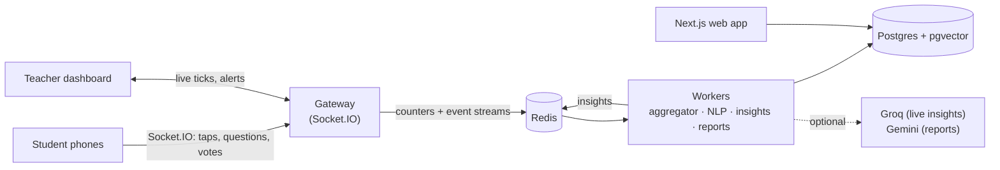

<h1 align="center">HandsUp</h1>

<p align="center"><strong>Know the moment your class gets lost.</strong></p>

<p align="center">
Live, anonymous classroom feedback. Students react, ask and vote from their phones with no account.<br>
The teacher sees how well the room is following in real time and gets an AI-written report after class.
</p>

<p align="center">
  
</p>

<p align="center">
  
  &nbsp;&nbsp;
  
</p>

---

## Why

In a lecture hall, most students never raise their hand. By the time a teacher learns that a topic didn't land (in office hours, or in the exam results), the lecture is long over. HandsUp gives every student a silent, anonymous way to say "I'm lost" in the moment, and gives the teacher a live signal they can act on before the class ends.

## Features

**For students (no account, ever)**
- Join by QR code or a 6-character code.
- Five one-tap reactions: *Got it*, *Too fast*, *Too slow*, *Example please*, *I'm confused*, plus a 1 to 5 clarity rating.
- Ask questions and upvote others'. The top three appear on a podium.
- Polls that open on their own, and automatic rejoin after a lost signal.

**For teachers**
- **Live dashboard:**
  - Students here, engaged %, an **Understanding score (0 to 100)** and a 5-second timeline with slide markers.
  - **AI insights**: alerts when confusion spikes, the pace is off or many students ask the same thing, each with a suggested action.
  - Similar questions grouped automatically, plus trending words.
  - Polls (prepared or quick), presenter mode, keyboard shortcuts and an optional alert sound.
- **After class:**
  - A report within a minute: AI summary, understanding chart, key moments, most asked topics and a slide-by-slide breakdown.
  - PDF and CSV export, and a read-only share link.
- **Courses:** group lectures, compare them, and download a **term report** (PDF and CSV) for the whole course.
- Google sign-in and a guided first lecture with demo students.

**Privacy built in**
- Students are anonymous: per-lecture salted device IDs, no names and no accounts.
- Rate limits, a profanity filter, one-tap hide and mute, and an optional review-first mode for questions.
- Raw taps are deleted after 7 days, and student content after each lecture's retention period.

**Polish:** light and dark themes, subtle animations that respect *reduce motion*, keyboard focus rings, a skip link and WCAG AA contrast.

## How it works



1. Phones batch taps every 0.5 s and send them to the **gateway**, which validates and rate-limits them, then updates Redis counters and streams.
2. Every second, the gateway pushes a live tick to the teacher. Every 5 seconds, the **aggregator** saves a time window to Postgres and the timeline grows.
3. The **NLP worker** embeds each question with a small local model and groups similar ones using pgvector. The **insights worker** applies rules for instant alerts and, if a key is set, asks Groq to word them.
4. When class ends, the **report worker** builds the recap. Gemini writes the summary if a key is set; otherwise a rule-based summary is used.

Everything works without any AI keys. The AI only improves the wording.

## Tech stack

| Area | Built with |
| --- | --- |
| Web app | Next.js 15 (App Router), React 19, TypeScript, Tailwind CSS, Auth.js (Google), Lucide icons |
| Realtime | Socket.IO gateway, Redis (counters, streams, pub/sub) |
| Background jobs | Node workers: aggregation, local NLP (MiniLM embeddings, DistilBERT sentiment via Transformers.js), alerts, reports, data cleanup |
| Database | PostgreSQL 16 with pgvector, Drizzle ORM and migrations |
| AI (free tiers, optional) | Groq (Llama) for live insights, Google Gemini Flash for report summaries |
| Reports | pdf-lib (PDF), CSV export, Open Graph share images |
| Quality | Vitest unit tests, Playwright end-to-end test, k6 load test (1,000 students), GitHub Actions CI |
| Tooling | pnpm workspaces monorepo, Docker Compose for local Postgres and Redis |

## Project structure

```
handsup/
├── apps/
│   ├── web/                 # Next.js app: public pages, teacher area, student phone app, API routes
│   │   ├── src/app/         #   routes (/, /j/[code] student app, /courses, /sessions/[id]/live, /report, /api/...)
│   │   ├── src/components/  #   UI components (icons, charts, motion, report)
│   │   ├── src/lib/         #   server helpers (auth checks, PDF/CSV, term report)
│   │   └── test/            #   unit tests for web helpers
│   ├── gateway/             # Socket.IO realtime server (/s students, /t teachers)
│   │   └── scripts/         #   simulate.ts: fake students for testing
│   └── workers/             # background jobs: aggregator, NLP, AI insights, reports, demo students, cleanup
├── packages/
│   ├── shared/              # types, Zod schemas, socket events, Understanding score (browser-safe)
│   ├── server/              # Redis helpers, live snapshot, rate limits, profanity filter (server only)
│   └── db/                  # Drizzle schema, queries and SQL migrations
├── e2e/                     # Playwright end-to-end test (teacher + student, full lecture)
├── loadtest/                # k6 script: 1,000 students in one lecture
├── docs/
│   ├── SETUP.md             # full local setup, Google sign-in, phone testing, troubleshooting
│   └── screenshots/         # images used in this README
├── scripts/realtime.mjs     # runs gateway + workers as one service (free hosting)
├── .github/workflows/       # CI: typecheck, unit tests, build, e2e on every push
├── render.yaml              # Render blueprint: live server + Redis
├── docker-compose.yml       # local Postgres (pgvector) + Redis
├── .env.example             # every setting, with comments (copy to .env)
├── KEYS.md                  # what each key is for and where to get it
└── DEPLOY.md                # putting it online
```

## Quick start

You need **Node.js 20.11+** (22 recommended), **pnpm 10** and **Docker Desktop**.

```bash
pnpm install
cp .env.example .env       # then set AUTH_SECRET and REALTIME_SECRET (see docs/SETUP.md)
pnpm db:up                 # Postgres + Redis in Docker
pnpm db:migrate
pnpm dev                   # web :3000, gateway :4000, workers
```

Open http://localhost:3000, sign in with the developer login, and open the demo lecture: 25 demo students join and start reacting.

The full guide, including Google sign-in, AI keys, testing on a real phone and troubleshooting, is in **[docs/SETUP.md](docs/SETUP.md)**. Every setting is explained in **[KEYS.md](KEYS.md)**.

## Scripts

| Command | What it does |
| --- | --- |
| `pnpm dev` | Run web, gateway and workers together |
| `pnpm test` | Unit tests (no database needed) |
| `pnpm test:e2e` | Browser test of a full lecture (needs `pnpm db:up` and `pnpm db:migrate`) |
| `pnpm typecheck` / `pnpm build` | Type-check / production build of every package |
| `pnpm simulate CODE 100` | Add 100 fake students to a live lecture |
| `pnpm db:studio` | Browse the database |

## Deployment

Runs on free plans: the website on **Vercel**, the gateway and workers together as one **Render** service (`scripts/realtime.mjs`, set up by `render.yaml`), Redis on **Render Key Value** and Postgres on **Neon**. Step-by-step instructions are in **[DEPLOY.md](DEPLOY.md)**.

## Credits

Fonts: [Anton](https://fonts.google.com/specimen/Anton) and [Oswald](https://fonts.google.com/specimen/Oswald) (SIL Open Font License). Icons: [Lucide](https://lucide.dev) (ISC). Local models: [Xenova/all-MiniLM-L6-v2](https://huggingface.co/Xenova/all-MiniLM-L6-v2) and DistilBERT SST-2 via [Transformers.js](https://huggingface.co/docs/transformers.js).

## License

[MIT](LICENSE). Free to use, change and share, as long as the copyright notice stays.
